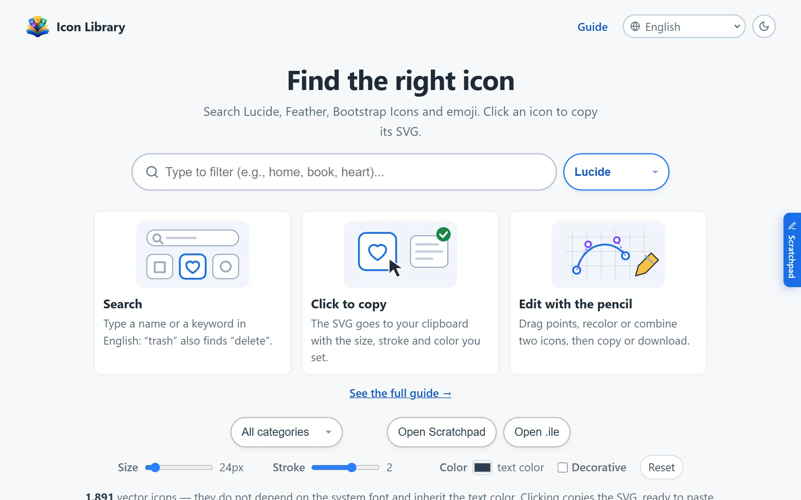
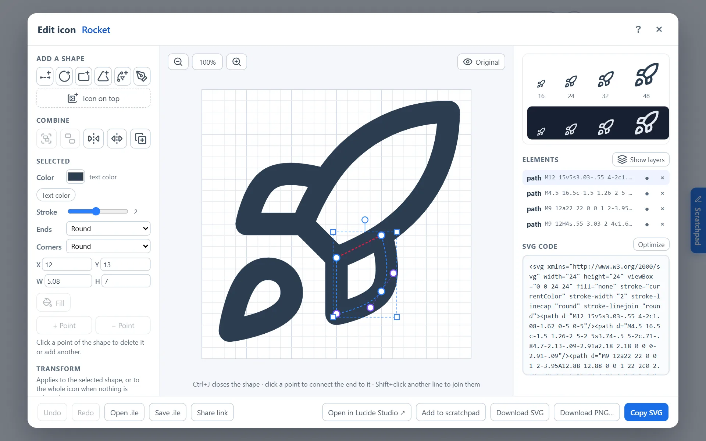

<p align="center">
  
</p>

<h1 align="center">Icon Library</h1>

<p align="center">
  <strong>Browse, customize and copy icons — free.</strong><br>
  Lucide · Feather · Bootstrap Icons · Emoji, with an SVG editor in the browser.
</p>

<p align="center">
  <a href="https://iconlibrary.io"></a>
  <a href="https://github.com/andremendesferreira/icon-library/actions/workflows/ci.yml"></a>
  <a href="LICENSE"></a>
  
  <a href="https://github.com/andremendesferreira/icon-library/discussions"></a>
  <a href="https://t.me/iconlibraryio"></a>
</p>

<p align="center">
  <a href="https://iconlibrary.io"><strong>Open the site</strong></a> ·
  <a href="https://github.com/andremendesferreira/icon-library/discussions">Ideas and questions</a> ·
  <a href="https://github.com/andremendesferreira/icon-library/issues/new/choose">Report a bug</a> ·
  <a href="CONTRIBUTING.md">Contributing</a>
</p>

<p align="center">
  <a href="https://iconlibrary.io"></a>
</p>

<p align="center">
  <a href="#english">English</a> · <a href="#português">Português</a>
</p>

---

## English

A page for browsing, filtering and copying icons from four sets — **Emoji (Unicode)**, **Lucide**, **Feather** and **Bootstrap Icons** — to use in menus and interfaces. Click an icon to copy its SVG; right-click to copy the alternative. The pencil on each card opens an **SVG editor** to reshape, recolor and combine icons, and supporters can publish what they make to **Iconlibrary**, the community set.

No framework, no build step and two runtime dependencies on the server (the PostgreSQL driver, for the coffee, Iconlibrary and bug reports, and an SVG→PNG renderer for moderation previews): plain HTML, CSS and JavaScript (ES modules, organized as MVC), served by a small Node.js server.

### Features

- **Search first:** the page opens on a large search field (focused with a mouse) next to the icon set, with three illustrated steps (search, click to copy, edit with the pencil) and a link to the Guide. The search stays at the top while you scroll, and the grid loads in batches as you go down. The size you choose resizes the previews, like the stroke and color. Design rules (minimalist, 18 px minimum for reading text and controls): [docs/design.md](docs/design.md).
- **Four icon sets** in one place, loaded on demand and cached after the first load. The page opens with Lucide, or with the set chosen last time (`icon-library:set`), without writing `?set=` to the address. Package versions are pinned (see [Icon versions](#icon-versions)).
- **Categories** with multi-select, and **search** by name and keyword (`/` jumps to it): Lucide's tags come from `lucide-static/tags.json`, and Feather's and Bootstrap's from `public/json/icons-tags.json`, generated from their repositories by `npm run tags` (run it again when a set version changes). Name matches come first, then exact tags, then partial ones. A search with no result offers to clear the search or the categories and to try the word in the other sets, with the count for sets already loaded. In Bootstrap Icons, *Outline* / *Filled* shows one of the two versions (`-fill`), also as `?style=outline|filled`.
- **Style before copying:** size, stroke width (Lucide, Feather) and color (all vector sets). Applied to everything copied, downloaded or sent to the scratchpad; the preview follows stroke and color. *Decorative* adds `aria-hidden="true"` for icons next to a text label. Remembered between visits.
- **Card buttons:**
  - **+** adds the icon to the scratchpad;
  - **⋯** opens *Download SVG*, *Download PNG* (at the chosen size) and copies the icon as a React, Vue or Svelte component, a data URI (`currentColor` becomes the chosen color) or a CSS class that uses `mask` and takes the text color;
  - the **pencil** (all vector sets) opens the icon editor.
- **Icon editor:** the icon on a grid, with draggable points for every shape — line, circle, ellipse, rect, polyline/polygon and path, including the control points of curves. Move shapes, rotate 90° or 45°, flip, grow/shrink (one shape or the whole icon), add and delete shapes (line, circle, rectangle, triangle, curve) and points, copy and paste shapes (Ctrl+C/V), hide a shape to compare, snap to the grid (1, ½, ¼ unit or off), undo/redo, live SVG code (editable both ways) and previews at 16–48 px. **Select several shapes:** drag on an empty area (Shift adds, from anywhere), Shift+click, Ctrl+A. **Group and ungroup** (Ctrl+G, Ctrl+Shift+G): a click selects the group, a double click one shape. **Join** two open lines, close a line, or connect its end to a selected point (Ctrl+J), **split** a shape where you click, and **stacking order** buttons. **Fill** a closed shape with the color of its line. **Gradient:** eight suggestions (sunset, ocean, purple…) or two colors of your own, linear with a direction or radial, on the fill or the stroke (straight lines too); one gradient covers the selection and follows it when shapes move (`public/js/models/degrade.js`). Iconlibrary only takes plain colors. **Show layers** paints each shape or group in its own color to show the order, without changing the icon. **Zoom and pan:** the wheel, the magnifier buttons or + / − zoom around the pointer, a two-finger pinch on phones, Space+drag or the middle button pans, 0 fits. **Selection box** with corner handles (resize, keeping proportions, in grid steps) and a rotate handle (15° steps); Shift frees both. **X, Y, width and height** fields for exact values. **Align and distribute** (several shapes with each other, or one shape, a group or the whole icon with the icon area). **Snapping** to the points and boxes of the other shapes and to the icon center, with guide lines (Alt turns it off). **Duplicate** (Ctrl+D) and Shift+arrows (ten grid steps). **Pen** tool: click for points, drag for curves, click the first point to close. **Stroke ends and corners** (round, flat, square; round, sharp, beveled). Hold **Original** to compare with the icon as opened, previews on a **light and a dark background**, and **Optimize** removes empty and repeated attributes and shortens paths. Delete, split, join and optimize show a toast with **Undo**, and the edit in progress is kept in the browser (`icon-library:editor-draft`) and offered back after a reload; closing the editor discards it. Drag shapes in the list to reorder them and rename groups; **Tab** on the drawing picks the next shape and announces it to screen readers. **Help:** the *?* button or key shows every command with its keys and mouse actions. **On a phone:** the drawing stays in view, with the tools in tabs, a bar with undo, redo, delete and multi-selection, a long press to add or remove a shape, and larger touch targets. **Icons on top of each other:** *Icon on top* searches the vector sets and adds another icon as a group, resized to the same grid and keeping its style (stroke or fill). **Per-shape color and stroke width** for a shape or a whole icon. **Projects in `.ile` files:** *Save .ile* downloads the project and *Open .ile* (editor, main page, or drag and drop) brings it back — see [The .ile format](#the-ile-format). Copy, download SVG/PNG or send to the scratchpad; single-style Lucide and Feather icons can also go to [Lucide Studio](https://studio.lucide.dev).
- **Scratchpad:** a drawer on the right edge (tab or *Open Scratchpad*) that collects icons as `<!-- name -->` followed by the SVG. Above the text, the icons it holds appear as a grid: a click opens one in the editor, and *Save to scratchpad* puts the edited version back in the same place. *Upload SVG* (or dropping files on the grid) adds SVG files, cleaned like code pasted into the editor. *Copy all* and *Clear* at the bottom; the text is kept in the browser.
- **Shareable searches:** the address follows the set and search (`?set=lucide&q=arrow`).
- **A guide to each set:** license, usage and comparisons for Lucide, Feather, Bootstrap Icons and Emoji, with a sample of icons in the page itself (English and Portuguese).
- **Articles:** hand-written case studies, starting with designing an icon for an LGPD tool (`lgpd-icon.html`, English and Portuguese).
- **Text pages** (Guide, About, Privacy, Licenses, set guides, articles) have a search field at the top (`/` focuses it) that opens the icons already filtered (`./?q=…`), and a breadcrumb (Icon Library › page, also as `BreadcrumbList` JSON-LD). The Guide opens with **Get started in 30 seconds**, the home's three illustrated steps. **Licenses** sums up the license of each set, what to keep when redistributing, and the note on brand logos.
- **Links that open the editor** — made by people (*Share link* in the editor) or by AI assistants: see [For AI assistants](#for-ai-assistants).
- **Light and dark themes:** follows the system, with a toggle in the header.
- **8 languages** — English, Español, Français, Deutsch, Русский, 中文（简体）, Português (Brasil), 日本語 — detected from the browser, with a selector in the header (see [Languages](#languages)).
- **Emoji glyph detection:** emojis your system font cannot draw are flagged and can be hidden.
- **Fast with large sets:** only categories near the screen are drawn; the rest are drawn as you scroll.
- **Guide**, **About** and **Privacy** pages, linked in the footer — the Guide explains every feature step by step, with screenshots and a table of keyboard shortcuts.
- **Responsive** from 360 px phones to wide desktops; keyboard support (arrows in the set list, `Esc` closes panels).

<p align="center"></p>

### Icon sets

| Set | Source | Categories | License |
|---|---|---|---|
| Emoji (Unicode) | [unicode-emoji-json](https://github.com/muan/unicode-emoji-json) | Official Unicode groups | MIT |
| Lucide | [lucide-static](https://lucide.dev) | Official, from the Lucide API | ISC |
| Feather | [feather-icons](https://feathericons.com) | Generated — `public/json/icons-categories.json` | MIT |
| Bootstrap Icons | [bootstrap-icons](https://icons.getbootstrap.com) | Generated — `public/json/icons-categories.json` | MIT |

Icon data is fetched at runtime from [unpkg](https://unpkg.com) (and the Lucide categories from `lucide.dev`), so the page needs internet access.

### Getting started

Requires **Node.js 20+** (24 recommended — the version used by Docker and CI).

```bash
npm start      # → http://localhost:8080   (another port: PORT=3000 npm start)
npm test       # unit and server tests
```

> Opened straight from disk (`file://`), the page does not work: browsers block ES modules and the categories file there, and copying only works on `https://` or `localhost`.

### Running with Docker

```bash
docker compose up -d --build                                              # production
docker compose -f docker-compose.yml -f docker-compose.dev.yml up --build # development: serves local files, no rebuild
```

The production container runs as a non-root user, with a read-only file system, no Linux capabilities, memory and process limits, and a healthcheck on `/api/health`, which answers 503 when a database check failed at start-up. Environment variables (in `docker-compose.yml`):

| Variable | Purpose |
|---|---|
| `SITE_URL` | Public address — `https://iconlibrary.io` — used in `/sitemap.xml` and `/robots.txt`. Without it, the address of each request is used. |
| `ADSENSE_PUBLISHER_ID` | Your `pub-…` ID. Enables `/ads.txt`, required by AdSense. |
| `INDEXNOW_KEY` | 8–128 letters, digits or dashes (`openssl rand -hex 16`). With `SITE_URL`, serves `/<key>.txt` and, a minute after each start, sends the sitemap to IndexNow, so Bing, Yandex and others recrawl changed pages within days. The key is public by design. |

### Deploying

- **HTTPS is required:** browsers only allow copying on secure pages. Put a reverse proxy with a certificate (Nginx, Caddy, Traefik…) in front of port 3000.
- **The server** (`scripts/server.js`) adds security headers, gzip, cache headers (pages revalidated on every visit, other files cached for a day with ETag), answers only `GET`/`HEAD`, rejects malformed addresses and never serves anything outside `public/`. It also generates `/robots.txt`, `/sitemap.xml` and `/ads.txt`.
- **Address:** the site is published at **https://iconlibrary.io**. The pages declare it as their canonical address and in the social-preview tags (`og:url`, `og:image`); if the domain changes, update `public/*.html` and `SITE_URL`.
- **Which version is live:** the footer of every page shows the commit the server runs (a link to it on GitHub) and the image build date, e.g. `v 9fb8dba · 2026-10-26`; the start-up log prints the same. If it is not the latest commit on GitHub, the server (Portainer) has not been updated yet. The Docker build reads the commit from `.git/HEAD` and `.git/refs/heads` (the only `.git` files let through by `.dockerignore`); without them — Portainer builds from the files only — it asks the GitHub API for the latest commit of `main`, the one just pulled. If that fails too, only the date is shown; the build never fails because of the version. A commit that changes nothing in the image (only docs, for example) reuses Docker's cache, so the footer keeps the previous version — and the running code is indeed the same.
- Other static hosts (GitHub Pages, Netlify) can serve `public/` too, but without the generated routes and the headers above.

### Advertising (Google AdSense)

Ad areas, never all at once:

- **Side rails:** two floating 160×600 rails, left and right, that stay in place while the page scrolls; the content narrows so nothing is covered.
- **Banner:** a horizontal banner below the header, used instead when the rails do not fit (window narrower than 1100 px or shorter than 630 px, e.g. phones).
- **Scratchpad:** a 160×600 unit inside the scratchpad drawer, next to the text. It is requested only once the drawer opens, and shown in windows at least 640 px wide and 750 px tall. While the drawer is open, the right rail is hidden.

They stay off until configured. To turn them on:

1. In `public/js/models/adsConfig.js`, fill in `cliente` (`ca-pub-…`) and the slot of each unit created in AdSense: three fixed 160×600 display units (two rails and the scratchpad) and one responsive display unit (banner). An area with an empty slot is not shown.
2. Set `ADSENSE_PUBLISHER_ID` so `/ads.txt` is served.
3. In the AdSense panel, under *Privacy & messaging*, enable the consent message for Europe (the code needs no change).
4. Review `public/privacy.html` — it describes the cookies used by AdSense, but it is a template: adapt it to who runs the site.

With `cliente` empty no Google script is loaded; on `localhost` the areas show as dashed previews.

### Usage analytics (Microsoft Clarity)

`public/js/views/clarity.js` loads Microsoft Clarity on every public page (`public/index.html` and the template in `scripts/build-pages.mjs`), but not on `localhost` or in `/admin`. To use your own project, change the ID at the end of the file. Anything that would expose a visitor's data in the session replays — the publish, coffee, *My icons* and bug report dialogs, the scratchpad and the editor's SVG code — carries `data-clarity-mask="true"`; keep the masking mode in the Clarity panel on *Balanced* or *Strict*. The site sends no consent signal, so in the EEA, the UK and Switzerland Clarity runs without cookies. The privacy policy describes it in all 8 languages.

### Buy me a coffee (30 days as a supporter)

Visitors can buy the developer a coffee (usually US$ 3) through Stripe; in return, for 30 days they can publish and edit icons on Iconlibrary and see no ads when the site shows them. The button only appears when Stripe and the database are configured.

1. **Payment:** the button opens a Stripe **Payment Link**. In its settings, *After payment* → redirect to `https://iconlibrary.io/?coffee={CHECKOUT_SESSION_ID}`.
2. **Confirmation:** back on the site, the page sends the session ID to `POST /api/coffee/redeem`. The server (`scripts/coffee.js`) asks Stripe whether it was paid and stores a row in PostgreSQL (table `coffee_supporters`, created automatically) with a **supporter code** valid until 30 days after the payment.
3. **Benefits:** the browser keeps the code and the end date; while it is valid the AdSense script is not even loaded. The code can be used on up to 3 devices (`POST /api/coffee/claim`), with a limit of 10 attempts per 15 minutes per IP.
4. **Stored:** only the Stripe session ID, amount, dates, code and device count — no name, e-mail or card data. The privacy policy describes this.
5. **Renewal:** a browser that knows its code (valid or expired) adds it to the Payment Link as `client_reference_id`. That payment extends the same code by 30 days — from the end of the current period, or from the payment if it already ended — and the device count starts over. The supporter keeps the Iconlibrary icons published with the code. Renewals are stored in `coffee_renewals` (migration 005); an expired code typed on another device answers `410 code_expired`, and the page offers to renew it.

Setup: copy `.env.example` to `.env` and fill in `STRIPE_SECRET_KEY` (a restricted key with *Checkout Sessions: Read* is enough), `STRIPE_PAYMENT_LINK`, `COFFEE_PRICE` and the `PG_*` variables. `docker-compose.yml` reads `.env` and reaches a PostgreSQL on the same server through `host.docker.internal`. Test first with Stripe test-mode keys and a test Payment Link.

### Iconlibrary (community icons)

A fifth set, **Iconlibrary**, holds icons published by supporters from the editor (*Publish to Iconlibrary*). It is on when the database and the coffee are configured.

- **Who publishes:** only supporters — the request carries a valid, unexpired supporter code. Up to 10 icons waiting for review per code; 20 submissions per 15 minutes per IP.
- **What is accepted:** a name (2–40 characters, unique among pending and approved icons), 1–3 categories from `public/json/iconlibrary-categories.json` (Lucide's categories), an optional public credit, and the acceptance of the **MIT license**. The SVG is checked on the server by `scripts/svgSafe.js`: only basic shapes with known attributes and well-formed values; anything else (text, groups, images, styles, scripts, links, entities) is refused, and the stored SVG is rewritten from scratch.
- **Review:** every icon starts as *pending*. The owner reviews them at **`/admin`** (HTTP Basic auth with `ADMIN_PASSWORD`; the page lives in `scripts/admin.html`, outside `public/`), approving, rejecting (the name becomes free again) or deleting. Approved icons appear within a minute.
- **API:** `GET /api/iconlibrary/icons` (approved icons), `POST /api/iconlibrary/icons` (submit), `GET /api/iconlibrary/config`; review: `GET /api/admin/icons?status=`, `POST /api/admin/icons/:id/approve|reject|delete`.

### Moderation API (n8n)

With `MODERATION_TOKEN` set (at least 32 characters, `openssl rand -hex 32`), an automated moderator can call `/api/moderation/…` with `Authorization: Bearer <token>`: `GET /api/moderation/icons` (pending icons), `GET /api/moderation/icons/:id/preview.png?size=256` (PNG preview, 16–512 px) and `POST /api/moderation/icons/:id/approve|reject|delete` (`{ note, submittedAt }`; pending icons only — a decision already made answers 409). `delete` removes only icons that never went live (pending or rejected); an approved one answers `409 approved` and is removed only in `/admin`. With `submittedAt`, the version the moderator saw, a decision about an icon the author has edited since answers `409 changed`. The token cannot open `/admin`, delete approved icons or read bug reports. [docs/moderacao-n8n.md](docs/moderacao-n8n.md) (Portuguese) describes an n8n + Ollama workflow that describes each icon without its name, compares it with the name and suggests a decision, plus a second workflow that puts a panel with Approve, Reject and Delete buttons under each Telegram message and edits it in place (reason, confirmation, result).

### Supporter reviews

Supporters can rate Icon Library from 1 to 5 stars with a comment (10–600 characters). Approved reviews appear on the **About** page, in all 8 languages, with the average and the count. It is on when the database and the coffee are configured.

- **Who reviews:** only a valid, unexpired supporter code, one review per code. Sending again replaces it; an approved review stays live until the edit is approved (`pending_json`). 15 requests per 15 minutes per IP.
- **How the person appears:** a name they type (1–40 characters) and an optional photo. The page crops the photo to a square in a canvas and sends a JPEG; the server accepts only PNG or JPEG up to 1024 px (read from the header, before decoding) and always redraws it as a 96×96 PNG with resvg (`avatarPng`), so metadata such as location goes away and the page never loads an image from another site.
- **Optional logins** (`scripts/oauth.js`): GitHub, Google and Microsoft, each on only with its `*_OAUTH_ID` and `*_OAUTH_SECRET`. Authorization code with PKCE and a one-time `state`, tied to the browser by an `HttpOnly` cookie (`il_review_login`, path `/api/reviews`); the server reads name, id and photo, drops the token at once and keeps only `sha256(provider:id)` as a "verified" badge. The callback returns to the About page with a short-lived ticket in the fragment (`#review-ticket=…`), and the form keeps what was typed in `sessionStorage` (`icon-library:review-draft`) during the trip. Callback address: `<SITE_URL>/api/reviews/auth/<provider>/callback`.
- **Moderation:** the *Reviews* tab in `/admin` (pending, approved, rejected; edits show the live version next to them), and the moderation API: `GET /api/moderation/reviews`, `GET /api/moderation/reviews/:id/avatar.png`, `POST /api/moderation/reviews/:id/approve|reject|delete` (`{ note, submittedAt }`, pending only). [docs/n8n-moderacao-avaliacoes.json](docs/n8n-moderacao-avaliacoes.json) sends each new review to Telegram with the same button panel.
- **No rating in structured data:** Google does not accept a site's reviews of itself (`AggregateRating`), so the stars are only on the page.
- **API:** `GET /api/reviews/config`, `GET /api/reviews`, `POST /api/reviews`, `POST /api/reviews/mine`, `GET /api/reviews/:id/avatar.png`, `GET /api/reviews/auth/:provider[/callback]`, `POST /api/reviews/identity`; admin: `GET /api/admin/reviews?status=`, `GET /api/admin/reviews/:id/avatar.png`, `POST /api/admin/reviews/:id/approve|reject|delete`. Table `reviews` (`migrations/006_reviews.sql`); if it is missing, only the reviews are off.

### Searches with no results

When a search finds nothing in the chosen set (and no category is filtering), the page waits 2 s and sends the term, the set and the language, once per term per visit. The server keeps one counter per term and set (`migrations/007_search_misses.sql`), never the IP; terms that look like personal data (e-mail, link, long number) are dropped. **/admin → Searches with no results** lists them, most searched first: the icons people want and cannot find. API: `POST /api/search-misses` (204), admin `GET /api/admin/search-misses`, `POST /api/admin/search-misses/delete`.

### Bug reports

- **Report a bug** in the footer (and on the guide, about and privacy pages) opens a form: what happened, an optional e-mail for a reply, and, sent along automatically, the page address, language, browser and window size. The IP is not stored. A hidden field catches bots, and each IP may send 5 reports per 15 minutes.
- The form also links to **GitHub Issues**, with the issue already filled in from what was typed; without the database, only that link is shown.
- For privacy requests and anything that shouldn't be public, write to contact@iconlibrary.io.
- Reports are read at **`/admin`**, under *Bug reports* (open / resolved), with a link to reply by e-mail.
- **API:** `GET /api/reports/config`, `POST /api/reports`; admin: `GET /api/admin/reports?status=open|resolved`, `POST /api/admin/reports/:id/resolve|reopen|delete`. Table `bug_reports` (`migrations/003_bug_reports.sql`); if it is missing, only the form is off.

### Database and migrations

The numbered SQL files in `migrations/` (`001_coffee_supporters.sql`, `002_iconlibrary_icons.sql`, `003_bug_reports.sql`…) are applied in order on start-up when `PG_HOST` is set, each in a transaction, under an advisory lock, and recorded in `schema_migrations`; `npm run migrate` applies them by hand. To change the schema, add a new file with the next number — never edit one that already ran. The `PG_USER` needs permission to create tables (on PostgreSQL 15+: `GRANT CREATE ON SCHEMA public TO …`). If the migrations fail, the site still runs, with the coffee, Iconlibrary and bug reports off. On every start the server also compares `migrations/` with `schema_migrations` and checks that each feature's tables exist with the privileges it needs (`FEATURE_TABLES` in `scripts/db.js`): a pending migration or a missing `GRANT` turns the features off, is logged as `[db] PENDING MIGRATIONS: …` or `GRANT missing`, and makes `/api/health` answer 503, so the container shows as unhealthy instead of failing at the first payment.

**Owner and application user (recommended):** let the owner role apply the migrations (`PG_USER=<owner> npm run migrate`) and run the site with an application role that only has `USAGE` on the schema, `SELECT, INSERT, UPDATE, DELETE` on the tables, `USAGE, SELECT` on the sequences and `SELECT` on `schema_migrations`; set `PG_MIGRATE=false` for it. Each new migration that creates a table needs its `GRANT` for that role, and the start-up check says when one is missing. Even without that flag, the server issues no `CREATE` when nothing is pending.

### Searching in other languages

Icon names and keywords are in English. A dictionary per language (`public/json/sinonimos/<lang>.json`, `{ "lixeira": ["trash", "delete"] }`) lets visitors search in their own language: the typed term is also looked up as its English equivalents, accent-insensitive, as a whole phrase, word by word ("seta direita" → `arrow-right`) or by prefix while typing (`public/js/models/sinonimos.js`). Dictionary terms only match whole words of a name or exact keywords, and they rank after direct matches. Only Portuguese has a dictionary for now (337 entries); `npm run synonyms` checks that every entry finds at least one Lucide, Feather or Bootstrap icon.

### Icon versions

The packages are pinned in `VERSOES` at the top of `public/js/models/iconSets.js`, so a new release cannot break the page on its own. To upgrade:

1. Change the version in `VERSOES` and, for Feather and Bootstrap, the same version in `scripts/generate-icon-categories.js` and `scripts/generate-icon-tags.js`.
2. Run `npm run generate` (refreshes the categories), `npm run tags` (refreshes the search keywords) and `npm test` — a test fails if the files disagree.
3. Check the page in the browser.

### Categories for Feather and Bootstrap

Neither Feather nor Bootstrap Icons publish categories; Lucide does, and since Lucide is a fork of Feather most names match. `scripts/generate-icon-categories.js` builds `public/json/icons-categories.json` by trying, in order:

| Strategy | Meaning |
|---|---|
| `exact` | Same name exists in Lucide — its categories are inherited |
| `tokens` | Same words in a different order (`alert-circle` ↔ `circle-alert`) |
| `base` | Same as above after removing a variant suffix (`house-fill` → `house`) |
| `approximate` | Keyword rules in the generator — an inference, not official data |
| `uncategorized` | Nothing matched — the icon goes to `others` |

Current coverage:

| Set | Icons | exact | tokens | base | approximate | uncategorized |
|---|---:|---:|---:|---:|---:|---:|
| Feather | 287 | 220 | 25 | 0 | 27 | 15 |
| Bootstrap | 2078 | 282 | 31 | 265 | 1500 | 0 |

The generated file is committed, so the page does not depend on the generator. If it cannot be loaded, Feather and Bootstrap icons are grouped by first letter instead.

### Adding an icon set

Sets are declared in `FONTES`, in `public/js/models/iconSets.js`. Each entry has:

| Field | Description |
|---|---|
| `rotulo` | Name shown in the set list |
| `rotuloGrupo` | Translation key of the category button label when nothing is selected (`categories.all`) |
| `rotuloGrupoAlternativo` | Translation key used when the categories source is unavailable, grouped by letter (`letters.all`) |
| `url` | One URL, or a list; each item is a string or `{ endereco, opcional, resposta: "texto" }` (`opcional`: failure is tolerated; `resposta: "texto"`: read as text) |
| `montar(data)` | Turns the downloaded data into items: `{ nome, tipo: "svg" \| "emoji", grupo, svg \| char, versao?, editavel? }` — `editavel: true` adds *Open in Lucide Studio* to the editor (24×24 stroke icons only) |
| `temTraco`, `temCor` | `true` enables the stroke and color controls for the set |
| `detectaGlifo` | `true` to check whether the system font can draw each item (emoji only) |

### Languages

The language is chosen, in this order, from `?lang=xx` in the address, the choice saved by the selector, the browser's languages (`pt-PT` → Português (Brasil), `zh-TW` → 中文（简体）) and finally English.

- **Main page:** translated in place. `public/js/i18n/detect.js` (in the `<head>`) picks the language and hides the page until `public/js/i18n/i18n.js` has loaded that language's dictionary (`public/js/i18n/<lang>.js`) and applied it to every element marked `data-i18n`, `data-i18n-html` or `data-i18n-attr`. Messages in the JavaScript use `t("key", { values })`; plurals follow `Intl.PluralRules`. Errors thrown by the models carry a code (`models/erros.js`) and are translated where they are shown. For search engines, `?lang=xx` versions are declared with `hreflang`.
- **Guide, About and Privacy:** one HTML file per language (`guide.pt-BR.html`…), generated by `npm run pages` from `pages/<page>/<lang>.html` plus the dictionaries. Edit the files in `pages/` and run the command; a test fails if the generated pages are out of date. The English page is the default: someone arriving there who prefers another language is sent to that version.
- **Not translated:** icon and category names (they come from the packages and are what the search matches), SVG code and `llms.txt`.
- **Adding a language:** add it to `IDIOMAS` in `detect.js`, `scripts/build-pages.mjs` and `tests/i18n.test.mjs`, create `public/js/i18n/<lang>.js` (same keys as `en.js` — the test checks keys, placeholders and HTML tags), `pages/guide/<lang>.html`, `pages/about/<lang>.html` and `pages/privacy/<lang>.html`, add the `hreflang` line to `index.html`, and run `npm run pages`. Right-to-left languages (Arabic, Hebrew) also need `dir="rtl"` and CSS review.

The Guide's screenshots (`public/img/guide/*.webp`) were taken from the site in English and are shared by every language; retake them when the interface changes.

The translations were made by AI and should be reviewed by native speakers — the privacy policy in particular, which is a legal text.

### For AI assistants

An AI can create an icon and hand it to the user as a link that opens it in the editor:

- `https://iconlibrary.io/#name=rocket&svg=<URL-encoded or base64url SVG>`
- `https://iconlibrary.io/#ile=<base64url or URL-encoded .ile JSON>` — several layered icons, groups, hidden shapes

The icon goes after `#`, so it never reaches the server. `svg=`/`ile=` must be the last parameter. Opening applies the same cleaning as pasted code; closing the editor removes the icon from the address.

[`public/llms.txt`](public/llms.txt) (served at `/llms.txt`) explains this to AIs, with the style rules and where to fetch real icons; [`public/schema/ile.schema.json`](public/schema/ile.schema.json) is the JSON Schema of the `.ile` format. Tests check that the examples in `llms.txt` open and are valid.

The next steps — an MCP server and an HTTP API, as a low-cost paid plan — are planned in [BACKLOG.md](BACKLOG.md).

### The .ile format

A `.ile` file is UTF-8 JSON text:

```json
{
  "formato": "icon-library-editor",
  "versao": 1,
  "nome": "heart",
  "editavel": true,
  "salvo": "2026-10-18T21:30:00.000Z",
  "raiz": { "xmlns": "http://www.w3.org/2000/svg", "viewBox": "0 0 24 24", "fill": "none", "stroke": "currentColor" },
  "grupos": [{ "nome": "heart" }, { "nome": "star fill" }],
  "elementos": [
    { "tag": "path", "attrs": { "d": "M2 9.5a5.5 5.5 0 0 1 …" }, "grupo": 0, "oculto": false },
    { "tag": "path", "attrs": { "d": "M8.113 18.593…", "fill": "#dc2626", "stroke": "none" }, "grupo": 1, "oculto": false }
  ]
}
```

- `raiz` holds the attributes of the `<svg>` tag; each element has its own attributes, the icon it belongs to (`grupo`, an index into `grupos`) and whether it is hidden. A group made with *Group* has `manual: true` in `grupos`. The exported SVG stays flat, with no `<g>`: groups exist only in the editor and in `.ile` files. Elements the editor cannot draw (`<g>`, `<text>`…) are kept as `html`.
- `editavel` keeps the *Open in Lucide Studio* button for Lucide and Feather icons.
- Opening validates the structure and passes everything through the same cleaning as pasted code: only SVG drawing elements stay (no `<script>`, `<foreignObject>`, `<a>`, `<style>`, animations, comments or processing instructions), event attributes are removed and links may only point inside the icon (`href="#…"`). Files over 2 MB, or saved by a newer version (`versao` above 1), are refused with a message.

### Tests and CI

`npm test` runs the tests in `tests/` with Node's built-in runner — SVG transformations, the editor's geometry (path parsing for every command, points, rotations, flips, undo/redo), filters, HTML escaping, the scratchpad, pinned versions, and the server (malformed addresses, path traversal, headers, gzip, ETag, generated routes, the start-up database checks and `/api/health`), and that every page loads Clarity with the sensitive areas masked. On GitHub, `.github/workflows/ci.yml` runs them on every push and pull request, checks the syntax of every script, and builds the Docker image and waits for its healthcheck.

### Project structure

```
icon-library/
├── public/                             the site
│   ├── index.html                      main page
│   ├── guide*.html, about*.html, privacy*.html  guide, about and privacy policy, one per language (generated)
│   ├── img/guide/                      screenshots used by the guide
│   ├── js/i18n/                        language detection, translation, one dictionary per language
│   ├── llms.txt                        instructions for AI assistants
│   ├── schema/ile.schema.json          JSON Schema of the .ile format
│   ├── css/icon-library.css            styles (light and dark)
│   ├── js/app.js                       entry point — wires models, views, controllers
│   ├── js/models/                      data and rules, no DOM
│   │   ├── iconSets.js                 the icon sets (FONTES) and pinned versions
│   │   ├── IconModel.js                loading, cache, filters, style, Studio link
│   │   ├── svgTools.js                 size/stroke/color, React, file names
│   │   ├── linkCodec.js                #svg= / #ile= links
│   │   ├── svgGeometry.js              editor geometry: paths, points, transforms
│   │   ├── EditorModel.js              icons being edited, groups, colors, undo/redo
│   │   ├── ScratchpadModel.js          scratchpad text, saved in the browser
│   │   ├── adsConfig.js                AdSense publisher and slot IDs
│   │   └── glyphDetector.js            can the system font draw this emoji?
│   ├── js/views/                       everything that touches the DOM
│   │   ├── IconView.js                 grid, panels, card menu, style controls
│   │   ├── EditorView.js               editor window, grid and draggable points
│   │   ├── ScratchpadView.js           scratchpad drawer
│   │   ├── AdsView.js                  ad areas
│   │   ├── html.js                     HTML escaping
│   │   ├── theme.js                    light/dark theme (all pages)
│   │   ├── goTop.js                    "back to top" button
│   │   └── clarity.js                  Microsoft Clarity (all pages, not localhost)
│   ├── js/controllers/
│   │   ├── IconController.js           user actions → model → view, address state
│   │   ├── EditorController.js         editor actions → model → view
│   │   ├── ScratchpadController.js     open/close, add, copy, clear
│   │   ├── clipboard.js                copy to the clipboard
│   │   └── download.js                 SVG and PNG downloads
│   ├── img/                                logo (WebP), favicon, touch and social icons
│   └── json/icons-categories.json      generated categories (Feather, Bootstrap)
├── scripts/server.js                   server (npm start)
├── scripts/build-pages.mjs             generates the text pages (npm run pages)
├── scripts/coffee.js                   buy me a coffee: Stripe check, supporter codes
├── scripts/iconlibrary.js              community icons: submit, list, review
├── scripts/reports.js                  bug reports from the footer form
├── scripts/reviews.js                  supporter reviews (About page) and avatar redraw
├── scripts/oauth.js                    GitHub/Google/Microsoft logins for reviews
├── scripts/cache.js                    API list responses kept ready: ETag, 304 and gzip
├── scripts/searchMisses.js             searches with no results, counted per term (/admin)
├── scripts/preview.js                  PNG previews for moderation
├── scripts/svgSafe.js                  strict check of submitted SVG
├── scripts/db.js                       PostgreSQL pool and migration runner (npm run migrate)
├── scripts/admin.html                  admin page (/admin): icons and bug reports
├── migrations/                         numbered SQL migrations
├── .env.example                        Stripe and PostgreSQL settings (copy to .env)
├── pages/                              text page content, one file per language
├── scripts/generate-icon-categories.js category generator
├── scripts/generate-icon-tags.js     search keywords for Feather and Bootstrap
├── tests/                              npm test
├── BACKLOG.md                          AI service and paid plan (next steps)
├── .github/workflows/ci.yml            continuous integration
├── .github/ISSUE_TEMPLATE/             issue forms (bug, translation) and links
├── docs/                               n8n moderation guide; README screenshots in docs/img/
├── CONTRIBUTING.md, SECURITY.md, CODE_OF_CONDUCT.md, CLAUDE.md
├── Dockerfile, docker-compose*.yml     container
└── package.json
```

`public/js/package.json` only marks the folder as ES modules, so Node can import those files in the tests.

### Contributing

Icons, bug reports, translation fixes and code are all welcome — see [CONTRIBUTING.md](CONTRIBUTING.md). Ideas and questions go to [Discussions](https://github.com/andremendesferreira/icon-library/discussions), news to the [Telegram channel](https://t.me/iconlibraryio), and security problems are reported privately as described in [SECURITY.md](SECURITY.md). Everyone follows the [Code of Conduct](CODE_OF_CONDUCT.md).

### Credits

Icon Library is created and maintained by **André M. Ferreira** ([iconlibrary.io](https://iconlibrary.io)).

Icons belong to their authors and are used under their licenses: [Lucide](https://github.com/lucide-icons/lucide/blob/main/LICENSE) (ISC), [Feather](https://github.com/feathericons/feather/blob/main/LICENSE) (MIT), [Bootstrap Icons](https://github.com/twbs/icons/blob/main/LICENSE) (MIT) and [unicode-emoji-json](https://github.com/muan/unicode-emoji-json/blob/main/LICENSE) (MIT). Emoji rendering depends on the fonts installed on each system.

---

## Português

Uma página para navegar, filtrar e copiar ícones de quatro conjuntos — **Emoji (Unicode)**, **Lucide**, **Feather** e **Bootstrap Icons** — para usar em menus e interfaces. Clique num ícone para copiar o SVG; clique com o botão direito para copiar a alternativa. O lápis de cada card abre um **editor de SVG** para mudar o desenho, as cores e combinar ícones, e os apoiadores podem publicar o que criam na **Iconlibrary**, o conjunto da comunidade.

Sem framework, sem build e com duas dependências no servidor (o driver do PostgreSQL, para o café, a Iconlibrary e os relatos de bug, e um renderizador de SVG para PNG, para as prévias da moderação): HTML, CSS e JavaScript puros (módulos ES, organizados em MVC), servidos por um pequeno servidor Node.js.

### Recursos

- **Busca em primeiro lugar:** a página abre numa busca grande (com o cursor nela, no computador) ao lado do conjunto, com três passos ilustrados (busque, clique para copiar, edite no lápis) e o link do Guia. A busca fica presa no topo ao rolar, e a grade carrega em lotes enquanto você desce. O tamanho escolhido muda as prévias, como o traço e a cor. Regras de design (minimalista, texto de leitura e controles com 18 px no mínimo): [docs/design.md](docs/design.md).
- **Quatro conjuntos** num só lugar, carregados sob demanda e guardados em cache depois da primeira carga. A página abre com o Lucide, ou com o último conjunto escolhido (`icon-library:set`), sem escrever `?set=` no endereço. As versões dos pacotes são fixas (veja [Versões dos ícones](#versões-dos-ícones)).
- **Categorias** com seleção múltipla e **busca** pelo nome e pelas palavras-chave (`/` leva até ela): as tags do Lucide vêm do `lucide-static/tags.json`, e as do Feather e do Bootstrap do `public/json/icons-tags.json`, gerado a partir dos repositórios por `npm run tags` (rode de novo quando a versão de um conjunto mudar). Acertos no nome vêm primeiro, depois tag igual, depois tag parcial. Uma busca sem resultado oferece limpar a busca ou as categorias e tentar a palavra nos outros conjuntos, com a contagem dos que já foram carregados. No Bootstrap Icons, *Contorno* / *Preenchido* mostra uma das duas versões (`-fill`), também como `?style=outline|filled`.
- **Estilo antes de copiar:** tamanho, espessura do traço (Lucide, Feather) e cor (todos os vetoriais). Vale para tudo o que é copiado, baixado ou enviado ao scratchpad; a prévia acompanha traço e cor. *Decorativo* acrescenta `aria-hidden="true"` para ícones ao lado de um texto. Fica lembrado entre visitas.
- **Botões do card:**
  - **+** envia o ícone ao scratchpad;
  - **⋯** abre *Download SVG*, *Download PNG* (no tamanho escolhido) e copia o ícone como componente React, Vue ou Svelte, como data URI (`currentColor` vira a cor escolhida) ou como classe CSS que usa `mask` e pega a cor do texto;
  - o **lápis** (todos os conjuntos vetoriais) abre o editor de ícones.
- **Editor de ícones:** o ícone sobre uma grade, com pontos arrastáveis em todas as formas — line, circle, ellipse, rect, polyline/polygon e path, incluindo os pontos de controle das curvas. Mover formas, girar 90° ou 45°, espelhar, aumentar/diminuir (uma forma ou o ícone inteiro), adicionar e apagar formas (linha, círculo, retângulo, triângulo, curva) e pontos, copiar e colar formas (Ctrl+C/V), ocultar uma forma para comparar, encaixe na grade (1, ½, ¼ de unidade ou livre), desfazer/refazer, código SVG ao vivo (editável nos dois sentidos) e prévias de 16 a 48 px. **Selecionar várias formas:** arraste no vazio (Shift soma, de qualquer ponto), Shift+clique, Ctrl+A. **Agrupar e desagrupar** (Ctrl+G, Ctrl+Shift+G): um clique seleciona o grupo, um duplo clique uma forma. **Unir** duas linhas abertas, fechar uma linha ou ligar a ponta a um ponto selecionado (Ctrl+J), **separar** uma forma onde você clicar e botões de **ordem**. **Preencher** uma forma fechada com a cor da linha. **Degradê:** oito sugestões (pôr do sol, oceano, roxo…) ou duas cores à escolha, linear com direção ou radial, no preenchimento ou no traço (linhas retas também); um degradê cobre a seleção e a acompanha quando as formas se movem (`public/js/models/degrade.js`). A Iconlibrary só aceita cores lisas. **Ver camadas** pinta cada forma ou grupo de uma cor para mostrar a ordem, sem mudar o ícone. **Zoom e deslocamento:** a roda, os botões de lupa ou + / − aproximam em volta do ponteiro, pinça com dois dedos no celular, Espaço+arrastar ou o botão do meio movem a vista, 0 ajusta. **Caixa da seleção** com alças nos cantos (tamanho na proporção, em passos da grade) e de giro (de 15 em 15 graus); Shift solta os dois. Campos de **X, Y, largura e altura** para valores exatos. **Alinhar e distribuir** (várias formas entre si, ou uma forma, um grupo ou o ícone inteiro na área do ícone). **Encaixe** nos pontos e caixas das outras formas e no centro do ícone, com linhas-guia (Alt desliga). **Duplicar** (Ctrl+D) e Shift+setas (dez passos da grade). **Caneta:** clique para pôr pontos, arraste para curvar, clique no primeiro ponto para fechar. **Pontas e cantos do traço** (redondas, retas, quadradas; redondos, pontudos, chanfrados). Segure **Original** para comparar com o ícone como foi aberto, prévias em **fundo claro e escuro**, e **Otimizar** tira atributos vazios ou repetidos e encurta paths. Apagar, separar, unir e otimizar mostram um aviso com **Desfazer**, e a edição em andamento fica guardada no navegador (`icon-library:editor-draft`) e é oferecida de volta depois de recarregar; fechar o editor a descarta. Arraste as formas na lista para reordenar e renomeie grupos; **Tab** no desenho escolhe a forma seguinte e a anuncia aos leitores de tela. **Ajuda:** o botão ou a tecla *?* mostra todos os comandos com as teclas e as ações do mouse. **No celular:** o desenho fica sempre à vista, com as ferramentas em abas, uma barra com desfazer, refazer, apagar e seleção de várias formas, toque longo para somar ou tirar uma forma, e alvos maiores para o toque. **Ícones sobrepostos:** *Ícone por cima* busca nos conjuntos vetoriais e acrescenta outro ícone como grupo, ajustado à mesma grade e com o próprio estilo (traço ou preenchimento). **Cor e espessura por forma**, numa forma ou num ícone inteiro. **Projetos em arquivos `.ile`:** *Save .ile* baixa o projeto e *Open .ile* (no editor, na página principal ou arrastando o arquivo) o traz de volta — veja [O formato .ile](#o-formato-ile). Copiar, baixar SVG/PNG ou enviar ao scratchpad; ícones do Lucide e do Feather de um estilo só também podem ir para o [Lucide Studio](https://studio.lucide.dev).
- **Scratchpad:** uma gaveta na borda direita (aba ou *Open Scratchpad*) que junta ícones como `<!-- nome -->` seguido do SVG. Em cima do texto, os ícones que ele tem aparecem numa grade: um clique abre o ícone no editor, e *Salvar no scratchpad* devolve a versão editada ao mesmo lugar. *Enviar SVG* (ou soltar arquivos sobre a grade) acrescenta arquivos SVG, com a mesma limpeza do código colado no editor. *Copy all* e *Clear* na base; o texto fica guardado no navegador.
- **Buscas compartilháveis:** o endereço acompanha o conjunto e a busca (`?set=lucide&q=arrow`).
- **Um guia para cada conjunto:** licença, uso e comparações do Lucide, Feather, Bootstrap Icons e Emoji, com uma amostra de ícones na própria página (inglês e português).
- **Artigos:** estudos de caso escritos à mão, começando pela criação de um ícone para uma ferramenta de LGPD (`lgpd-icon.html`, inglês e português).
- **Páginas de texto** (Guia, Sobre, Privacidade, Licenças, guias dos conjuntos, artigos) têm um campo de busca no topo (`/` leva até ele) que abre os ícones já filtrados (`./?q=…`), e um breadcrumb (Icon Library › página, também em JSON-LD `BreadcrumbList`). O Guia começa com **Comece em 30 segundos**, os três passos ilustrados da home. **Licenças** resume a licença de cada conjunto, o que manter ao redistribuir e o aviso sobre logotipos de marcas.
- **Links que abrem o editor** — feitos por pessoas (*Share link* no editor) ou por assistentes de IA: veja [Para assistentes de IA](#para-assistentes-de-ia).
- **Tema claro e escuro:** segue o sistema, com um botão no cabeçalho.
- **8 idiomas** — inglês, espanhol, francês, alemão, russo, chinês simplificado, português do Brasil e japonês — detectados pelo navegador, com um seletor no cabeçalho (veja [Idiomas](#idiomas)).
- **Detecção de glifo nos emojis:** emojis que a fonte do sistema não desenha são sinalizados e podem ser ocultados.
- **Rápida com conjuntos grandes:** só as categorias perto da tela são desenhadas; as demais, conforme a rolagem.
- Páginas **Guia**, **Sobre** e **Privacidade**, com links no rodapé — o Guia explica cada recurso passo a passo, com capturas de tela e uma tabela de atalhos de teclado.
- **Responsiva** de celulares de 360 px a monitores largos; teclado (setas na lista de conjuntos, `Esc` fecha painéis).

<p align="center"></p>

### Conjuntos de ícones

| Conjunto | Origem | Categorias | Licença |
|---|---|---|---|
| Emoji (Unicode) | [unicode-emoji-json](https://github.com/muan/unicode-emoji-json) | Grupos oficiais do Unicode | MIT |
| Lucide | [lucide-static](https://lucide.dev) | Oficiais, pela API do Lucide | ISC |
| Feather | [feather-icons](https://feathericons.com) | Geradas — `public/json/icons-categories.json` | MIT |
| Bootstrap Icons | [bootstrap-icons](https://icons.getbootstrap.com) | Geradas — `public/json/icons-categories.json` | MIT |

Os dados dos ícones são baixados em tempo de execução pelo [unpkg](https://unpkg.com) (e as categorias do Lucide pelo `lucide.dev`), então a página precisa de internet.

### Como rodar

Requer **Node.js 20+** (recomendado o 24 — a versão usada no Docker e no CI).

```bash
npm start      # → http://localhost:8080   (outra porta: PORT=3000 npm start)
npm test       # testes de unidade e do servidor
```

> Aberta direto do disco (`file://`), a página não funciona: o navegador bloqueia ali os módulos ES e o arquivo de categorias, e a cópia só funciona em `https://` ou `localhost`.

### Rodando com Docker

```bash
docker compose up -d --build                                              # produção
docker compose -f docker-compose.yml -f docker-compose.dev.yml up --build # desenvolvimento: serve os arquivos locais, sem rebuild
```

O container de produção roda sem root, com sistema de arquivos somente leitura, sem capabilities do Linux, com limites de memória e de processos, e healthcheck em `/api/health`, que responde 503 quando uma checagem do banco falhou na subida. Variáveis de ambiente (no `docker-compose.yml`):

| Variável | Para quê |
|---|---|
| `SITE_URL` | Endereço público — `https://iconlibrary.io` — usado em `/sitemap.xml` e `/robots.txt`. Sem ela, usa o endereço de cada requisição. |
| `ADSENSE_PUBLISHER_ID` | Seu ID `pub-…`. Liga o `/ads.txt`, exigido pelo AdSense. |
| `INDEXNOW_KEY` | De 8 a 128 letras, números ou hífens (`openssl rand -hex 16`). Com `SITE_URL`, serve `/<chave>.txt` e, um minuto depois de cada início, envia o sitemap ao IndexNow, para o Bing, o Yandex e outros lerem as páginas alteradas em dias. A chave é pública por natureza. |

### Publicação

- **HTTPS é obrigatório:** o navegador só permite copiar em páginas seguras. Coloque um proxy reverso com certificado (Nginx, Caddy, Traefik…) na frente da porta 3000.
- **O servidor** (`scripts/server.js`) envia cabeçalhos de segurança, gzip e cabeçalhos de cache (páginas revalidadas a cada visita, demais arquivos guardados por um dia com ETag), aceita só `GET`/`HEAD`, recusa endereços malformados e nunca serve nada fora de `public/`. Ele também gera `/robots.txt`, `/sitemap.xml` e `/ads.txt`.
- **Endereço:** o site é publicado em **https://iconlibrary.io**. As páginas o declaram como endereço canônico e nas tags de prévia em redes sociais (`og:url`, `og:image`); se o domínio mudar, atualize `public/*.html` e `SITE_URL`.
- **Qual versão está no ar:** o rodapé de todas as páginas mostra o commit que o servidor está rodando (com link para ele no GitHub) e a data do build da imagem, por exemplo `v 9fb8dba · 2026-10-26`; o log de inicialização mostra o mesmo. Se não for o último commit do GitHub, o servidor (Portainer) ainda não foi atualizado. O build do Docker lê o commit em `.git/HEAD` e `.git/refs/heads` (os únicos arquivos da `.git` que o `.dockerignore` deixa passar); sem eles — o Portainer monta a imagem só com os arquivos — pergunta à API do GitHub o último commit da `main`, o que acabou de ser baixado. Se isso também falhar, aparece só a data; o build nunca falha por causa da versão. Um commit que não muda nada na imagem (só documentação, por exemplo) reaproveita o cache do Docker, e o rodapé continua com a versão anterior — e o código em execução é de fato o mesmo.
- Outros hosts estáticos (GitHub Pages, Netlify) também servem `public/`, mas sem as rotas geradas e os cabeçalhos acima.

### Publicidade (Google AdSense)

Áreas de anúncio, nunca todas ao mesmo tempo:

- **Laterais:** duas laterais flutuantes de 160×600, à esquerda e à direita, que ficam paradas enquanto a página rola; o conteúdo encolhe para que nada fique encoberto.
- **Faixa:** uma faixa horizontal abaixo do cabeçalho, usada no lugar das laterais quando elas não cabem (janela com menos de 1100 px de largura ou 630 px de altura, como em celulares).
- **Scratchpad:** um bloco de 160×600 dentro da gaveta do scratchpad, ao lado do texto. Só é pedido quando a gaveta abre, e aparece em janelas com pelo menos 640 px de largura e 750 px de altura. Com a gaveta aberta, a lateral direita some.

Elas ficam desligadas até serem configuradas. Para ligar:

1. Em `public/js/models/adsConfig.js`, preencha `cliente` (`ca-pub-…`) e o slot de cada bloco criado no AdSense: três blocos de display fixos de 160×600 (duas laterais e o scratchpad) e um bloco de display responsivo (faixa). Área com slot vazio não aparece.
2. Defina `ADSENSE_PUBLISHER_ID` para o `/ads.txt` ser servido.
3. No painel do AdSense, em *Privacidade e mensagens*, ative a mensagem de consentimento para a Europa (o código não muda).
4. Revise o `public/privacy.html` — ele descreve os cookies do AdSense, mas é um modelo: adapte-o a quem mantém o site.

Com `cliente` vazio nenhum script do Google é carregado; em `localhost` as áreas aparecem como prévias tracejadas.

### Estatísticas de uso (Microsoft Clarity)

`public/js/views/clarity.js` carrega o Microsoft Clarity em todas as páginas públicas (`public/index.html` e o modelo em `scripts/build-pages.mjs`), mas não em `localhost` nem no `/admin`. Para usar o seu próprio projeto, troque o ID no fim do arquivo. Tudo que exporia dados de quem visita nas gravações — as janelas de publicar, do café, de *Meus ícones* e de relato de bug, o scratchpad e o código SVG do editor — leva `data-clarity-mask="true"`; deixe o mascaramento no painel do Clarity em *Balanced* ou *Strict*. O site não envia sinal de consentimento, então no Espaço Econômico Europeu, no Reino Unido e na Suíça o Clarity roda sem cookies. A política de privacidade descreve isso nas 8 línguas.

### Pague um café (30 dias como apoiador)

Quem visita pode pagar um café ao desenvolvedor (normalmente US$ 3) pelo Stripe e, em troca, por 30 dias pode publicar e editar ícones na Iconlibrary e não vê anúncios quando o site os exibir. O botão só aparece com o Stripe e o banco configurados.

1. **Pagamento:** o botão abre um **Payment Link** do Stripe. Nas configurações dele, *Após o pagamento* → redirecionar para `https://iconlibrary.io/?coffee={CHECKOUT_SESSION_ID}`.
2. **Confirmação:** de volta ao site, a página envia o ID da sessão para `POST /api/coffee/redeem`. O servidor (`scripts/coffee.js`) pergunta ao Stripe se foi pago e grava no PostgreSQL (tabela `coffee_supporters`, criada automaticamente) um **código de apoiador** válido até 30 dias depois do pagamento.
3. **Benefícios:** o navegador guarda o código e a data de fim; enquanto vale, o script do AdSense nem é carregado. O código serve em até 3 aparelhos (`POST /api/coffee/claim`), com limite de 10 tentativas a cada 15 minutos por IP.
4. **O que é guardado:** só o ID da sessão no Stripe, valor, datas, código e número de aparelhos — sem nome, e-mail ou dados do cartão. A política de privacidade descreve isso.
5. **Renovação:** o navegador que conhece o código (vigente ou expirado) o coloca no Payment Link como `client_reference_id`. Esse pagamento estende o mesmo código por 30 dias — a partir do fim do período atual, ou do pagamento se já terminou — e a contagem de aparelhos recomeça. O apoiador continua dono dos ícones da Iconlibrary publicados com o código. As renovações ficam em `coffee_renewals` (migration 005); um código expirado digitado em outro aparelho responde `410 code_expired`, e a página oferece renová-lo.

Configuração: copie o `.env.example` para `.env` e preencha `STRIPE_SECRET_KEY` (basta uma chave restrita com *Checkout Sessions: Read*), `STRIPE_PAYMENT_LINK`, `COFFEE_PRICE` e as variáveis `PG_*`. O `docker-compose.yml` lê o `.env` e alcança um PostgreSQL no mesmo servidor por `host.docker.internal`. Teste antes com as chaves e um Payment Link do modo de teste do Stripe.

### Iconlibrary (ícones da comunidade)

Um quinto conjunto, **Iconlibrary**, reúne ícones publicados por apoiadores a partir do editor (*Publicar na Iconlibrary*). Ele fica ligado quando o banco e o café estão configurados.

- **Quem publica:** só apoiadores — o envio leva um código de apoiador válido e não vencido. Até 10 ícones aguardando revisão por código; 20 envios a cada 15 minutos por IP.
- **O que é aceito:** um nome (2 a 40 caracteres, único entre pendentes e aprovados), de 1 a 3 categorias de `public/json/iconlibrary-categories.json` (as do Lucide), um crédito público opcional e o aceite da **licença MIT**. O SVG é conferido no servidor pelo `scripts/svgSafe.js`: só formas básicas, com atributos conhecidos e valores bem formados; qualquer outra coisa (texto, grupos, imagens, estilos, scripts, links, entidades) é recusada, e o SVG guardado é reescrito do zero.
- **Revisão:** todo ícone começa *pendente*. O dono revisa em **`/admin`** (autenticação HTTP Basic com `ADMIN_PASSWORD`; a página fica em `scripts/admin.html`, fora de `public/`), aprovando, recusando (o nome volta a ficar livre) ou excluindo. Os aprovados aparecem em até um minuto.
- **API:** `GET /api/iconlibrary/icons` (aprovados), `POST /api/iconlibrary/icons` (envio), `GET /api/iconlibrary/config`; revisão: `GET /api/admin/icons?status=`, `POST /api/admin/icons/:id/approve|reject|delete`.

### API de moderação (n8n)

Com `MODERATION_TOKEN` definido (mínimo de 32 caracteres, `openssl rand -hex 32`), um moderador automático chama `/api/moderation/…` com `Authorization: Bearer <token>`: `GET /api/moderation/icons` (pendentes), `GET /api/moderation/icons/:id/preview.png?size=256` (prévia em PNG, de 16 a 512 px) e `POST /api/moderation/icons/:id/approve|reject|delete` (`{ note, submittedAt }`; só pendentes — uma decisão já tomada responde 409). `delete` só remove o que nunca foi ao ar (pendente ou recusado); um ícone aprovado responde `409 approved` e só sai pelo `/admin`. Com `submittedAt`, a versão que o moderador viu, uma decisão sobre um ícone que o autor editou depois responde `409 changed`. O token não abre o `/admin`, não exclui ícones aprovados e não lê os relatos de bug. O guia [docs/moderacao-n8n.md](docs/moderacao-n8n.md) monta um fluxo n8n + Ollama que descreve cada ícone sem o nome, compara com o nome enviado e sugere a decisão, e um segundo fluxo que põe, embaixo de cada mensagem do Telegram, um painel com os botões Aprovar, Recusar e Excluir, editado no lugar (motivo, confirmação, resultado).

### Avaliações dos apoiadores

Apoiadores podem dar ao Icon Library uma nota de 1 a 5 estrelas, com um comentário (10 a 600 caracteres). As aprovadas aparecem na página **Sobre**, nos 8 idiomas, com a média e o total. Fica ligado quando o banco e o café estão configurados.

- **Quem avalia:** só um código de apoiador válido e não vencido, uma avaliação por código. Enviar de novo substitui; uma avaliação aprovada continua no ar até a edição ser aprovada (`pending_json`). 15 pedidos a cada 15 minutos por IP.
- **Como a pessoa aparece:** um nome digitado (1 a 40 caracteres) e uma foto opcional. A página recorta a foto num quadrado, num canvas, e manda um JPEG; o servidor só aceita PNG ou JPEG de até 1024 px (lidos no cabeçalho, antes de decodificar) e sempre a redesenha como PNG de 96×96 com o resvg (`avatarPng`), então metadados como a localização somem e a página nunca carrega imagem de outro site.
- **Logins opcionais** (`scripts/oauth.js`): GitHub, Google e Microsoft, cada um ligado só com o seu `*_OAUTH_ID` e `*_OAUTH_SECRET`. Código de autorização com PKCE e `state` de uso único, preso ao navegador por um cookie `HttpOnly` (`il_review_login`, caminho `/api/reviews`); o servidor lê nome, id e foto, descarta o token na hora e guarda só `sha256(provedor:id)` como selo de "verificado". A volta do login cai na página Sobre com um ticket de vida curta no fragmento (`#review-ticket=…`), e o formulário guarda o que foi digitado no `sessionStorage` (`icon-library:review-draft`) durante a ida. Endereço de retorno: `<SITE_URL>/api/reviews/auth/<provedor>/callback`.
- **Moderação:** a aba *Avaliações* do `/admin` (pendentes, aprovadas, recusadas; a edição aparece ao lado da versão no ar) e a API de moderação: `GET /api/moderation/reviews`, `GET /api/moderation/reviews/:id/avatar.png`, `POST /api/moderation/reviews/:id/approve|reject|delete` (`{ note, submittedAt }`, só pendentes). O [docs/n8n-moderacao-avaliacoes.json](docs/n8n-moderacao-avaliacoes.json) manda cada avaliação nova ao Telegram com o mesmo painel de botões.
- **Sem nota nos dados estruturados:** o Google não aceita avaliações de um site sobre si mesmo (`AggregateRating`), então as estrelas ficam só na página.
- **API:** `GET /api/reviews/config`, `GET /api/reviews`, `POST /api/reviews`, `POST /api/reviews/mine`, `GET /api/reviews/:id/avatar.png`, `GET /api/reviews/auth/:provedor[/callback]`, `POST /api/reviews/identity`; admin: `GET /api/admin/reviews?status=`, `GET /api/admin/reviews/:id/avatar.png`, `POST /api/admin/reviews/:id/approve|reject|delete`. Tabela `reviews` (`migrations/006_reviews.sql`); se ela faltar, só as avaliações ficam desligadas.

### Buscas sem resultado

Quando uma busca não acha nada no conjunto escolhido (e nenhuma categoria está filtrando), a página espera 2 s e manda o termo, o conjunto e o idioma, uma vez por termo em cada visita. O servidor guarda um contador por termo e conjunto (`migrations/007_search_misses.sql`), nunca o IP; termos que parecem dado pessoal (e-mail, link, número comprido) são descartados. **/admin → Buscas sem resultado** lista os termos, dos mais buscados para os menos: os ícones que as pessoas querem e não acham. API: `POST /api/search-misses` (204), admin `GET /api/admin/search-misses`, `POST /api/admin/search-misses/delete`.

### Relatos de bug

- **Reportar bug**, no rodapé (e nas páginas de guia, sobre e privacidade), abre um formulário: o que aconteceu, um e-mail opcional para resposta e, enviados automaticamente, o endereço da página, o idioma, o navegador e o tamanho da janela. O IP não é guardado. Um campo escondido barra robôs, e cada IP pode enviar 5 relatos a cada 15 minutos.
- O formulário também leva ao **GitHub Issues**, com o issue já preenchido com o que foi digitado; sem o banco, só esse link aparece.
- Para pedidos de privacidade e o que não deve ficar público, escreva para contact@iconlibrary.io.
- Os relatos são lidos em **`/admin`**, na aba *Relatos de bug* (abertos / resolvidos), com um link para responder por e-mail.
- **API:** `GET /api/reports/config`, `POST /api/reports`; admin: `GET /api/admin/reports?status=open|resolved`, `POST /api/admin/reports/:id/resolve|reopen|delete`. Tabela `bug_reports` (`migrations/003_bug_reports.sql`); se ela faltar, só o formulário fica desligado.

### Banco de dados e migrations

Os arquivos SQL numerados em `migrations/` (`001_coffee_supporters.sql`, `002_iconlibrary_icons.sql`, `003_bug_reports.sql`…) são aplicados em ordem na subida, quando `PG_HOST` está definido — cada um numa transação, sob um lock consultivo, e registrados em `schema_migrations`; `npm run migrate` os aplica manualmente. Para mudar o esquema, crie um arquivo novo com o próximo número — nunca edite um que já rodou. O `PG_USER` precisa de permissão para criar tabelas (no PostgreSQL 15+: `GRANT CREATE ON SCHEMA public TO …`). Se as migrations falharem, o site continua no ar, com o café, a Iconlibrary e os relatórios de bug desligados. A cada subida o servidor também compara `migrations/` com `schema_migrations` e confere se as tabelas de cada recurso existem com os privilégios de que ele precisa (`FEATURE_TABLES` em `scripts/db.js`): uma migration pendente ou um `GRANT` faltando desliga os recursos, aparece no log como `[db] PENDING MIGRATIONS: …` ou `GRANT missing` e faz o `/api/health` responder 503 — o container fica *unhealthy* em vez de falhar no primeiro pagamento.

**Dono e usuário da aplicação (recomendado):** deixe o papel dono aplicar as migrations (`PG_USER=<dono> npm run migrate`) e rode o site com um papel de aplicação que tenha só `USAGE` no schema, `SELECT, INSERT, UPDATE, DELETE` nas tabelas, `USAGE, SELECT` nas sequências e `SELECT` em `schema_migrations`; para ele, defina `PG_MIGRATE=false`. Cada migration nova que cria uma tabela precisa do `GRANT` para esse papel, e a checagem da subida avisa quando falta. Mesmo sem essa opção, o servidor não executa nenhum `CREATE` quando não há migration pendente.

### Busca em outros idiomas

Os nomes e as palavras-chave dos ícones são em inglês. Um dicionário por idioma (`public/json/sinonimos/<idioma>.json`, `{ "lixeira": ["trash", "delete"] }`) deixa quem visita buscar na própria língua: o termo digitado também é procurado pelos equivalentes em inglês, sem diferenciar acentos, como frase inteira, palavra por palavra ("seta direita" → `arrow-right`) ou pelo começo enquanto se digita (`public/js/models/sinonimos.js`). Os termos do dicionário só batem com palavras inteiras do nome ou palavras-chave exatas, e vêm depois dos acertos diretos. Por enquanto só o português tem dicionário (337 entradas); `npm run synonyms` confere se cada entrada acha ao menos um ícone do Lucide, do Feather ou do Bootstrap.

### Versões dos ícones

Os pacotes ficam fixos em `VERSOES`, no início de `public/js/models/iconSets.js`, para que uma versão nova não quebre a página sozinha. Para atualizar:

1. Troque a versão em `VERSOES` e, para Feather e Bootstrap, a mesma versão em `scripts/generate-icon-categories.js` e `scripts/generate-icon-tags.js`.
2. Rode `npm run generate` (atualiza as categorias), `npm run tags` (atualiza as palavras-chave da busca) e `npm test` — um teste falha se os arquivos discordarem.
3. Confira a página no navegador.

### Categorias do Feather e do Bootstrap

Nem o Feather nem o Bootstrap Icons publicam categorias; o Lucide publica e, como é um fork do Feather, a maioria dos nomes coincide. O `scripts/generate-icon-categories.js` monta o `public/json/icons-categories.json` tentando, nesta ordem:

| Estratégia | Significado |
|---|---|
| `exact` | O mesmo nome existe no Lucide — herda as categorias dele |
| `tokens` | As mesmas palavras em outra ordem (`alert-circle` ↔ `circle-alert`) |
| `base` | Igual ao anterior, depois de remover um sufixo de variante (`house-fill` → `house`) |
| `approximate` | Regras de palavra-chave do gerador — inferência, não dado oficial |
| `uncategorized` | Nada casou — o ícone vai para `others` |

Cobertura atual:

| Conjunto | Ícones | exact | tokens | base | approximate | uncategorized |
|---|---:|---:|---:|---:|---:|---:|
| Feather | 287 | 220 | 25 | 0 | 27 | 15 |
| Bootstrap | 2078 | 282 | 31 | 265 | 1500 | 0 |

O arquivo gerado é versionado, então a página não depende do gerador. Se ele não puder ser carregado, os ícones do Feather e do Bootstrap são agrupados pela primeira letra.

### Adicionar um conjunto

Os conjuntos ficam em `FONTES`, em `public/js/models/iconSets.js`. Cada entrada tem:

| Campo | Descrição |
|---|---|
| `rotulo` | Nome exibido na lista de conjuntos |
| `rotuloGrupo` | Chave de tradução do rótulo do botão de categorias quando nada está selecionado (`categories.all`) |
| `rotuloGrupoAlternativo` | Chave de tradução usada quando a fonte de categorias está indisponível, agrupado por letra (`letters.all`) |
| `url` | Uma URL ou uma lista; cada item é uma string ou `{ endereco, opcional, resposta: "texto" }` (`opcional`: a falha é tolerada; `resposta: "texto"`: lê como texto) |
| `montar(dados)` | Converte os dados baixados em itens: `{ nome, tipo: "svg" \| "emoji", grupo, svg \| char, versao?, editavel? }` — `editavel: true` adiciona *Open in Lucide Studio* ao editor (só ícones de traço 24×24) |
| `temTraco`, `temCor` | `true` liga os controles de traço e de cor para o conjunto |
| `detectaGlifo` | `true` para verificar se a fonte do sistema desenha cada item (só emoji) |

### Idiomas

O idioma é escolhido, nesta ordem, por `?lang=xx` no endereço, pela escolha salva no seletor, pelos idiomas do navegador (`pt-PT` → português do Brasil, `zh-TW` → chinês simplificado) e, por fim, inglês.

- **Página principal:** traduzida no lugar. O `public/js/i18n/detect.js` (no `<head>`) escolhe o idioma e esconde a página até o `public/js/i18n/i18n.js` carregar o dicionário (`public/js/i18n/<idioma>.js`) e aplicá-lo aos elementos marcados com `data-i18n`, `data-i18n-html` ou `data-i18n-attr`. As mensagens no JavaScript usam `t("chave", { valores })`; os plurais seguem `Intl.PluralRules`. Os erros lançados pelos models têm um código (`models/erros.js`) e são traduzidos onde aparecem. Para os buscadores, as versões `?lang=xx` são declaradas com `hreflang`.
- **Guia, Sobre e Privacidade:** um HTML por idioma (`guide.pt-BR.html`…), gerado por `npm run pages` a partir de `pages/<pagina>/<idioma>.html` e dos dicionários. Edite os arquivos em `pages/` e rode o comando; um teste falha se as páginas geradas estiverem desatualizadas. A página em inglês é a padrão: quem chega nela preferindo outro idioma vai para a versão dele.
- **Não traduzido:** nomes de ícones e de categorias (vêm dos pacotes e são o que a busca procura), código SVG e `llms.txt`.
- **Adicionar um idioma:** inclua-o em `IDIOMAS` no `detect.js`, no `scripts/build-pages.mjs` e no `tests/i18n.test.mjs`; crie `public/js/i18n/<idioma>.js` (mesmas chaves do `en.js` — o teste confere chaves, marcadores e tags HTML), `pages/guide/<idioma>.html`, `pages/about/<idioma>.html` e `pages/privacy/<idioma>.html`; acrescente a linha `hreflang` no `index.html` e rode `npm run pages`. Idiomas da direita para a esquerda (árabe, hebraico) também precisam de `dir="rtl"` e revisão do CSS.

As capturas de tela do Guia (`public/img/guide/*.webp`) foram feitas do site em inglês e são as mesmas em todos os idiomas; refaça-as quando a interface mudar.

As traduções foram feitas por IA e devem ser revisadas por falantes nativos — principalmente a política de privacidade, que é um texto jurídico.

### Para assistentes de IA

Uma IA pode criar um ícone e entregá-lo como um link que abre o editor:

- `https://iconlibrary.io/#name=rocket&svg=<SVG codificado para URL ou em base64url>`
- `https://iconlibrary.io/#ile=<JSON do .ile em base64url ou codificado para URL>` — vários ícones sobrepostos, grupos, formas ocultas

O ícone vai depois do `#`, então nunca chega ao servidor. `svg=`/`ile=` deve ser o último parâmetro. Ao abrir, passa pela mesma limpeza do código colado; ao fechar o editor, o ícone sai do endereço.

O [`public/llms.txt`](public/llms.txt) (servido em `/llms.txt`) explica isso às IAs, com as regras de estilo e de onde buscar ícones reais; o [`public/schema/ile.schema.json`](public/schema/ile.schema.json) é o JSON Schema do formato `.ile`. Os testes conferem que os exemplos do `llms.txt` abrem e são válidos.

Os próximos passos — servidor MCP e API HTTP, num plano pago de baixo custo — estão no [BACKLOG.md](BACKLOG.md).

### O formato .ile

Um arquivo `.ile` é texto JSON em UTF-8, com a estrutura do exemplo em [The .ile format](#the-ile-format):

- `raiz` guarda os atributos da tag `<svg>`; cada elemento tem seus atributos, o ícone a que pertence (`grupo`, posição em `grupos`) e se está oculto. Um grupo feito com *Agrupar* tem `manual: true` em `grupos`. O SVG exportado continua sem `<g>`: os grupos existem só no editor e nos arquivos `.ile`. Elementos que o editor não desenha (`<g>`, `<text>`…) ficam em `html`.
- `editavel` mantém o botão *Open in Lucide Studio* para ícones do Lucide e do Feather.
- Ao abrir, a estrutura é validada e tudo passa pela mesma limpeza do código colado: só ficam elementos de desenho do SVG (sem `<script>`, `<foreignObject>`, `<a>`, `<style>`, animações, comentários ou instruções de processamento), os atributos de evento saem e os links só podem apontar para dentro do ícone (`href="#…"`). Arquivos acima de 2 MB, ou salvos por uma versão mais nova (`versao` acima de 1), são recusados com uma mensagem.

### Testes e CI

`npm test` roda os testes de `tests/` com o executor nativo do Node — transformações de SVG, a geometria do editor (leitura de paths com todos os comandos, pontos, giros, espelhos, desfazer/refazer), filtros, escape de HTML, scratchpad, versões fixas e o servidor (endereços malformados, fuga de pasta, cabeçalhos, gzip, ETag, rotas geradas, as checagens do banco na subida e o `/api/health`), e que todas as páginas carregam o Clarity com as áreas sensíveis mascaradas. No GitHub, `.github/workflows/ci.yml` roda os testes a cada push e pull request, confere a sintaxe de todos os scripts, faz o build da imagem Docker e espera o healthcheck.

### Estrutura

```
icon-library/
├── public/                             o site
│   ├── index.html                      página principal
│   ├── guide*.html, about*.html, privacy*.html  guia, sobre e política de privacidade, um por idioma (gerados)
│   ├── img/guide/                      capturas de tela usadas no guia
│   ├── js/i18n/                        detecção de idioma, tradução, um dicionário por idioma
│   ├── llms.txt                        instruções para assistentes de IA
│   ├── schema/ile.schema.json          JSON Schema do formato .ile
│   ├── css/icon-library.css            estilos (claro e escuro)
│   ├── js/app.js                       ponto de entrada — liga models, views e controllers
│   ├── js/models/                      dados e regras, sem DOM
│   │   ├── iconSets.js                 os conjuntos (FONTES) e as versões fixas
│   │   ├── IconModel.js                carga, cache, filtros, estilo, link do Studio
│   │   ├── svgTools.js                 tamanho/traço/cor, React, nomes de arquivo
│   │   ├── linkCodec.js                links #svg= / #ile=
│   │   ├── svgGeometry.js              geometria do editor: paths, pontos, transformações
│   │   ├── EditorModel.js              ícones em edição, grupos, cores, desfazer/refazer
│   │   ├── ScratchpadModel.js          texto do scratchpad, guardado no navegador
│   │   ├── adsConfig.js                IDs de editor e de blocos do AdSense
│   │   └── glyphDetector.js            a fonte do sistema desenha este emoji?
│   ├── js/views/                       tudo o que toca o DOM
│   │   ├── IconView.js                 grade, painéis, menu do card, controles de estilo
│   │   ├── EditorView.js               janela do editor, grade e pontos arrastáveis
│   │   ├── ScratchpadView.js           gaveta do scratchpad
│   │   ├── AdsView.js                  áreas de publicidade
│   │   ├── html.js                     escape de HTML
│   │   ├── theme.js                    tema claro/escuro (todas as páginas)
│   │   ├── goTop.js                    botão "voltar ao topo"
│   │   └── clarity.js                  Microsoft Clarity (todas as páginas, fora de localhost)
│   ├── js/controllers/
│   │   ├── IconController.js           ações do usuário → model → view, estado no endereço
│   │   ├── EditorController.js         ações do editor → model → view
│   │   ├── ScratchpadController.js     abrir/fechar, adicionar, copiar, limpar
│   │   ├── clipboard.js                cópia para a área de transferência
│   │   └── download.js                 downloads de SVG e PNG
│   ├── img/                                logo (WebP), favicon, ícones de toque e de redes sociais
│   └── json/icons-categories.json      categorias geradas (Feather, Bootstrap)
├── scripts/server.js                   servidor (npm start)
├── scripts/build-pages.mjs             gera as páginas de texto (npm run pages)
├── scripts/coffee.js                   pague um café: confirmação no Stripe, códigos de apoiador
├── scripts/iconlibrary.js              ícones da comunidade: envio, lista, revisão
├── scripts/reports.js                  relatos de bug do formulário do rodapé
├── scripts/reviews.js                  avaliações dos apoiadores (página Sobre) e foto redesenhada
├── scripts/oauth.js                    logins GitHub/Google/Microsoft das avaliações
├── scripts/cache.js                    respostas das listas da API prontas: ETag, 304 e gzip
├── scripts/searchMisses.js             buscas sem resultado, contadas por termo (/admin)
├── scripts/preview.js                  prévias em PNG para a moderação
├── scripts/svgSafe.js                  conferência estrita do SVG enviado
├── scripts/db.js                       conexão com o PostgreSQL e migrations (npm run migrate)
├── scripts/admin.html                  administração (/admin): ícones e relatos de bug
├── migrations/                         migrations SQL numeradas
├── .env.example                        configurações do Stripe e do PostgreSQL (copie para .env)
├── pages/                              conteúdo das páginas de texto, um arquivo por idioma
├── scripts/generate-icon-categories.js gerador de categorias
├── scripts/generate-icon-tags.js     palavras-chave da busca do Feather e do Bootstrap
├── tests/                              npm test
├── BACKLOG.md                          serviço para IAs e plano pago (próximos passos)
├── .github/workflows/ci.yml            integração contínua
├── .github/ISSUE_TEMPLATE/             formulários de issue (bug, tradução) e links
├── docs/                               guia da moderação no n8n; prints do README em docs/img/
├── CONTRIBUTING.md, SECURITY.md, CODE_OF_CONDUCT.md, CLAUDE.md
├── Dockerfile, docker-compose*.yml     container
└── package.json
```

O `public/js/package.json` só marca a pasta como módulos ES, para o Node conseguir importar esses arquivos nos testes.

### Como contribuir

Ícones, relatos de bug, correções de tradução e código são bem-vindos — veja o [CONTRIBUTING.md](CONTRIBUTING.md). Ideias e dúvidas vão para as [Discussions](https://github.com/andremendesferreira/icon-library/discussions), as novidades para o [canal do Telegram](https://t.me/iconlibraryio), e problemas de segurança são reportados em privado, como explica o [SECURITY.md](SECURITY.md). Todos seguem o [Código de Conduta](CODE_OF_CONDUCT.md).

### Créditos

O Icon Library é criado e mantido por **André M. Ferreira** ([iconlibrary.io](https://iconlibrary.io)).

Os ícones pertencem aos seus autores e são usados sob as respectivas licenças: [Lucide](https://github.com/lucide-icons/lucide/blob/main/LICENSE) (ISC), [Feather](https://github.com/feathericons/feather/blob/main/LICENSE) (MIT), [Bootstrap Icons](https://github.com/twbs/icons/blob/main/LICENSE) (MIT) e [unicode-emoji-json](https://github.com/muan/unicode-emoji-json/blob/main/LICENSE) (MIT). A aparência dos emojis depende das fontes instaladas em cada sistema.
